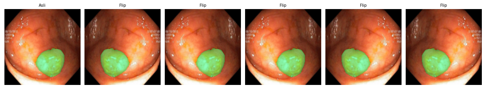
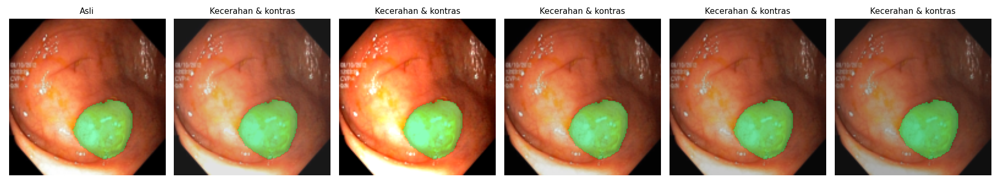
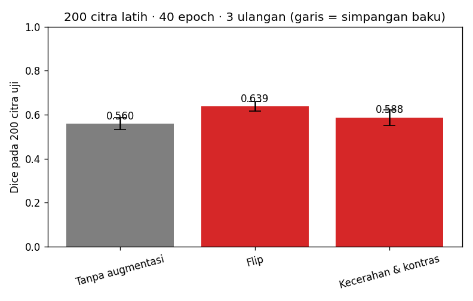
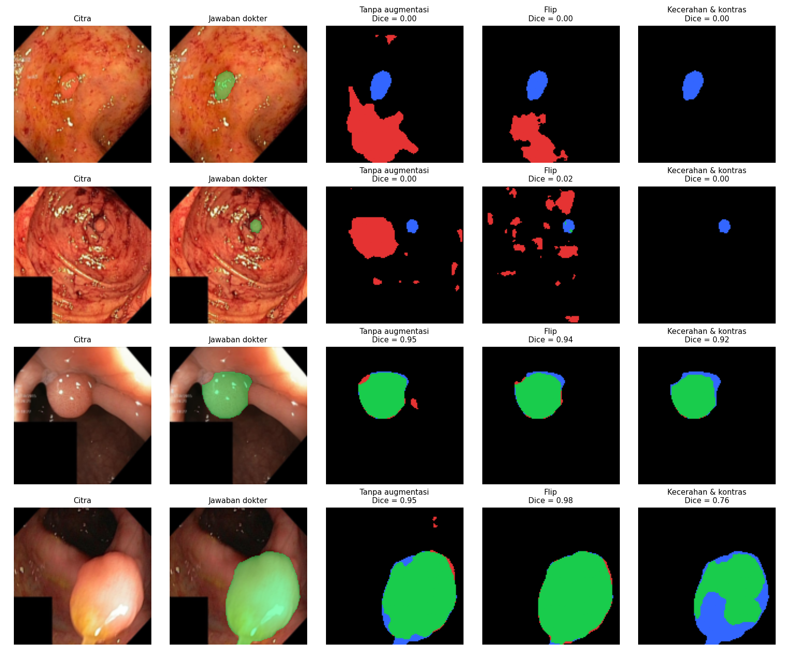

# Segmentasi Polip pada Citra Kolonoskopi dengan U-Net

**Tugas P10 — Kecerdasan Buatan (BM25-41204), Teknik Biomedis ITERA**

## Anggota kelompok

| Nama | NIM | Username GitHub | Kontribusi utama |
|---|---|---|---|
| Nadira Aulivia Az Zahra | 123430071 | NadiraAuliviaAzZahra | Persiapan repository, implementasi dan pengujian notebook U-Net, eksperimen akhir, pengolahan hasil, serta finalisasi |
| Puri Andhana Ht Sibero | 123430013 | puriandhana | Penyusunan skenario augmentasi, alasan klinis, dan hipotesis pada Bagian 3 |
| Andini Nurul Fitri | 123430103 | Belum diisi | Analisis peta kesalahan, pembahasan hasil, dan kesimpulan pada Bagian 5 dan 6 |

## 1. Pertanyaan

Augmentasi apa yang membantu U-Net menemukan polip pada citra kolonoskopi, dan augmentasi apa yang tidak? Kenapa?

## 2. Data & pengaturan

- **Dataset:** Kvasir-SEG, terdiri dari 1.000 citra kolonoskopi dan mask polip yang diperkecil menjadi 128 × 128 piksel.
- **Data uji:** 200 citra yang digunakan secara tetap.
- **Kumpulan data latih:** 800 citra, dengan 200 citra dipilih pada setiap ulangan.
- **Model:** U-Net mini (±0,5 juta parameter).
- **Jumlah epoch:** 40.
- **Jumlah ulangan:** 3 untuk setiap skenario.
- **Jumlah skenario:** 3 (Tanpa augmentasi, Flip, Kecerahan & Kontras).
- **Total eksperimen:** 9 proses training.
- **Perangkat:** Google Colab dengan GPU NVIDIA Tesla T4 (CUDA).
- **Mode eksperimen:** `CEPAT = False`.

Pembagian data dilakukan menggunakan random seed tetap agar data uji konsisten. Pada setiap ulangan, pemilihan citra latih menggunakan seed sesuai nomor ulangan, dan ketiga skenario menggunakan kumpulan citra latih yang sama pada ulangan tersebut.

Contoh citra kolonoskopi dan mask polip dari dataset Kvasir-SEG:


## 3. Skenario augmentasi & hipotesis

Tiga skenario eksperimen digunakan untuk mengevaluasi pengaruh augmentasi terhadap kemampuan model U-Net melakukan segmentasi polip. Hipotesis disusun sebelum eksperimen akhir dijalankan.

| Skenario | Augmentasi (kode) | Alasan klinis | Hipotesis: Dice naik/turun/sama? |
|---|---|---|---|
| Tanpa augmentasi | — | Pembanding | — |
| Flip | `v2.Compose([v2.RandomHorizontalFlip(), v2.RandomVerticalFlip()])` | Kamera endoskop berputar bebas di dalam usus, jadi tidak ada arah "atas" atau "kiri" yang pasti. Polip bisa muncul di sisi mana pun dinding usus. Foto yang di-flip tetap masuk akal secara klinis dan bentuk polip tidak berubah, berbeda dengan X-ray dada tempat flip memindahkan jantung ke sisi lain. | Naik. Dengan hanya 200 citra latih, flip menambah variasi posisi dan arah polip yang realistis sehingga model tidak menghafal letak tertentu dan overfitting berkurang. |
| Kecerahan & Kontras | `v2.ColorJitter(brightness=0.3, contrast=0.3)` | Terang gambar endoskopi tidak selalu sama. Lampu ada di ujung kamera, jadi kecerahan berubah menurut jarak dan sudut kamera ke mukosa, pantulan cairan atau lendir, dan perbedaan alat. Polip bisa tampak lebih terang atau gelap dan kurang kontras terhadap mukosa di sekitarnya. | Naik sedikit atau sama. Kenaikannya diperkirakan lebih kecil daripada Flip, karena foto Kvasir-SEG berasal dari rumah sakit dan alat yang relatif seragam sehingga variasi pencahayaan antara data latih dan uji tidak besar. |

### Visualisasi augmentasi

**1. Augmentasi Flip**

Augmentasi Flip menggunakan perubahan orientasi horizontal dan vertikal pada citra beserta mask polip. Perubahan dilakukan secara bersamaan agar posisi mask tetap sesuai dengan citra.



**2. Augmentasi Kecerahan & Kontras**

Augmentasi Kecerahan & Kontras menggunakan `ColorJitter` untuk menghasilkan variasi pencahayaan citra kolonoskopi tanpa mengubah posisi mask polip.



## 4. Hasil

Eksperimen akhir dilakukan menggunakan 200 citra latih, 40 epoch, dan 3 ulangan pada setiap skenario. Evaluasi dilakukan menggunakan 200 citra uji yang sama untuk seluruh skenario.

Metrik evaluasi yang digunakan adalah Dice Score dan Intersection over Union (IoU). Hasil disajikan dalam bentuk rata-rata dan simpangan baku dari tiga ulangan.

### Tabel hasil eksperimen

| Skenario | Dice (rata-rata ± SD) | IoU (rata-rata ± SD) | Dice tiap ulangan |
|---|---|---|---|
| Tanpa augmentasi | 0.560 ± 0.028 | 0.446 ± 0.020 | 0.581, 0.578, 0.520 |
| Flip | 0.639 ± 0.021 | 0.525 ± 0.019 | 0.621, 0.626, 0.669 |
| Kecerahan & Kontras | 0.588 ± 0.035 | 0.472 ± 0.025 | 0.538, 0.617, 0.609 |

### Grafik perbandingan

Grafik berikut menunjukkan perbandingan rata-rata Dice Score pada ketiga skenario. Garis kesalahan menunjukkan simpangan baku dari tiga ulangan eksperimen.



Berdasarkan hasil eksperimen, skenario Flip menghasilkan Dice Score rata-rata tertinggi sebesar 0.639, diikuti Kecerahan & Kontras sebesar 0.588, dan Tanpa augmentasi sebesar 0.560.

Hasil lengkap setiap ulangan dan konfigurasi eksperimen tersedia pada file `hasil/hasil.json` dan `hasil/ringkasan.md`.

## 5. Analisis peta kesalahan



**Bagian ini dikerjakan oleh Andini Nurul Fitri.**

Analisis akan membahas:

1. Interpretasi peta kesalahan segmentasi model.
2. False Positive, yaitu area bukan polip yang diprediksi sebagai polip.
3. False Negative, yaitu area polip yang tidak berhasil terdeteksi.
4. Karakteristik polip yang sulit disegmentasi.
5. Perbedaan kesalahan antara ketiga skenario augmentasi.
6. Pengaruh augmentasi terhadap hasil segmentasi pada contoh citra yang sulit.

*Analisis akhir akan dilengkapi berdasarkan hasil eksperimen yang telah tersedia.*

## 6. Pembahasan & kesimpulan

**Bagian ini dikerjakan oleh Andini Nurul Fitri.**

Pembahasan akan mencakup:

1. Perbandingan performa model pada ketiga skenario.
2. Kesesuaian hasil eksperimen dengan hipotesis pada Bagian 3.
3. Penjelasan kemungkinan penyebab perbedaan Dice Score dan IoU.
4. Kelebihan dan keterbatasan augmentasi yang digunakan.
5. Kesimpulan mengenai pengaruh augmentasi terhadap segmentasi polip menggunakan U-Net.

*Pembahasan dan kesimpulan akan dilengkapi setelah analisis hasil eksperimen selesai.*

## 7. Pembagian kerja

Pembagian tugas dilakukan berdasarkan tahapan persiapan, perancangan eksperimen, implementasi, analisis, dan finalisasi.

| Anggota | Tanggung jawab | Hasil pekerjaan |
|---|---|---|
| Nadira Aulivia Az Zahra | Persiapan repository, konfigurasi Git, pengujian notebook, pelaksanaan eksperimen akhir, pengolahan hasil, dan finalisasi | Notebook U-Net, hasil eksperimen, grafik, tabel evaluasi, dan dokumentasi README |
| Puri Andhana Ht Sibero | Penyusunan skenario augmentasi beserta alasan klinis dan hipotesis | README Bagian 3 |
| Andini Nurul Fitri | Analisis peta kesalahan, interpretasi hasil, pembahasan hipotesis, dan kesimpulan | README Bagian 5 dan 6 (menunggu penyelesaian) |

Kontribusi anggota didokumentasikan melalui riwayat commit pada repository GitHub menggunakan akun masing-masing.

## 8. Penggunaan AI

Dalam pengerjaan tugas ini, Nadira menggunakan ChatGPT sebagai alat bantu untuk:

1. Pendampingan penggunaan Git, GitHub, dan Google Colab.
2. Membantu pemeriksaan konfigurasi notebook sebelum eksperimen akhir.
3. Membantu interpretasi awal output eksperimen, termasuk Dice Score, IoU, dan grafik perbandingan.
4. Membantu menyusun dan merapikan dokumentasi README.

Eksperimen U-Net dijalankan menggunakan notebook Python di Google Colab. Nilai Dice Score, IoU, serta visualisasi yang dilaporkan berasal dari hasil eksekusi notebook, bukan angka yang dibuat oleh AI.

**Catatan:** Penggunaan AI oleh Puri dan Andini perlu dikonfirmasi kepada masing-masing anggota dan dilengkapi sebelum pengumpulan akhir.

## Cara menjalankan ulang

Repository dapat dijalankan menggunakan lingkungan Python yang sesuai dengan file `pyproject.toml`.

```bash
uv sync
uv run jupyter lab segmentasi_polip.ipynb
```

Alternatifnya, buka notebook `segmentasi_polip.ipynb` menggunakan Google Colab, kemudian pilih:

**Runtime → Change runtime type → T4 GPU**

Pastikan pengaturan eksperimen akhir menggunakan:

```python
CEPAT = False
JUMLAH_CITRA_LATIH = 200
JUMLAH_EPOCH = 40
JUMLAH_ULANGAN = 3
```

Jalankan notebook secara berurutan untuk mempersiapkan dataset, menerapkan augmentasi, melatih model U-Net, melakukan evaluasi, dan menghasilkan visualisasi.

Hasil eksperimen disimpan dalam folder `hasil/`. Dataset asli tidak dimasukkan ke repository GitHub.

## Referensi

1. Jha, D., dkk. (2020). Kvasir-SEG: A Segmented Polyp Dataset. *MultiMedia Modeling (MMM 2020)*, 451–462.

2. Ronneberger, O., Fischer, P., & Brox, T. (2015). U-Net: Convolutional Networks for Biomedical Image Segmentation. *MICCAI*. arXiv:1505.04597.
