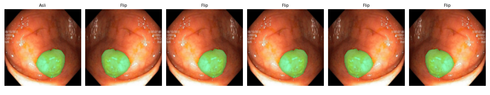
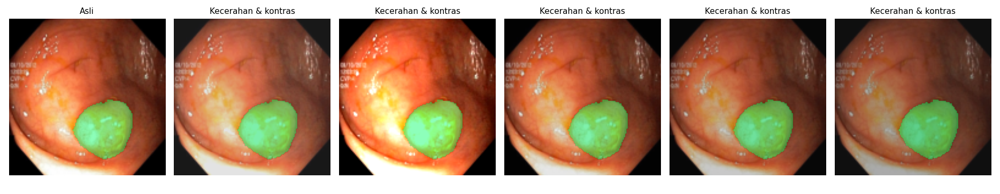
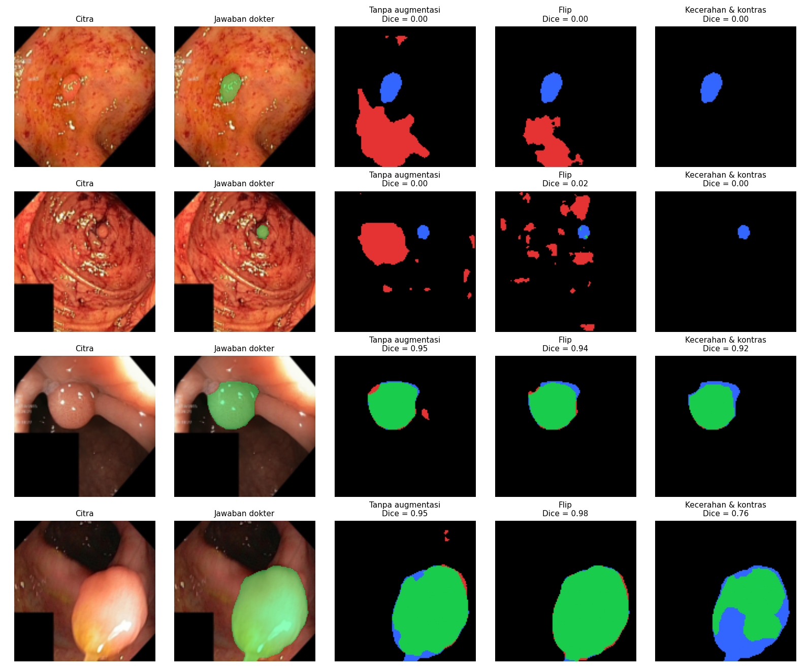

# Segmentasi Polip pada Citra Kolonoskopi dengan U-Net

**Tugas P10 — Kecerdasan Buatan (BM25-41204), Teknik Biomedis ITERA**

## Anggota kelompok

| Nama | NIM | Username GitHub | Kontribusi utama |
|---|---|---|---|
| Nadira Aulivia Az Zahra | 123430071 | NadiraAuliviaAzZahra | Persiapan repository, implementasi dan pengujian notebook U-Net, eksperimen akhir, pengolahan hasil, serta finalisasi |
| Puri Andhana Ht Sibero | 123430013 | puriandhana | Penyusunan skenario augmentasi, alasan klinis, dan hipotesis pada Bagian 3 |
| Andini Nurul Fitri | 123430103 | andininurul | Analisis peta kesalahan, pembahasan hasil, dan kesimpulan pada Bagian 5 dan 6 |

## 1. Pertanyaan

Augmentasi apa yang membantu U-Net menemukan polip pada citra kolonoskopi, dan augmentasi apa yang tidak? Kenapa?

## 2. Data & pengaturan

- **Dataset:** Kvasir-SEG, berisi 1.000 citra kolonoskopi beserta mask polip, yang diperkecil menjadi 128 × 128 piksel.
- **Data uji:** 200 citra yang dipertahankan sama untuk seluruh skenario.
- **Kumpulan data latih:** 800 citra, dengan 200 citra dipilih pada setiap ulangan.
- **Model:** U-Net mini (sekitar 0,5 juta parameter).
- **Jumlah epoch:** 40.
- **Jumlah ulangan:** 3 pada setiap skenario.
- **Skenario:** Tanpa augmentasi, Flip, dan Kecerahan & Kontras.
- **Total eksperimen:** 9 proses training.
- **Perangkat:** Google Colab dengan GPU NVIDIA Tesla T4 (CUDA).
- **Mode eksperimen:** `CEPAT = False`.

Pembagian data uji menggunakan *random seed* tetap. Pada setiap ulangan, ketiga skenario menggunakan pilihan 200 citra latih yang sama dan titik awal model yang disamakan untuk membuat perbandingan lebih adil.

Contoh citra kolonoskopi dan mask acuan dari dataset Kvasir-SEG:


## 3. Skenario augmentasi & hipotesis

Tiga skenario digunakan untuk mengevaluasi pengaruh augmentasi terhadap segmentasi polip. Hipotesis berikut ditulis dan di-*commit* oleh Puri sebelum eksperimen akhir dijalankan.

| Skenario | Augmentasi (kode) | Alasan klinis | Hipotesis: Dice naik/turun/sama? |
|---|---|---|---|
| Tanpa augmentasi | — | Pembanding | — |
| Flip | `v2.Compose([v2.RandomHorizontalFlip(), v2.RandomVerticalFlip()])` | Kamera endoskop berputar bebas di dalam usus, jadi tidak ada arah "atas" atau "kiri" yang pasti. Polip bisa muncul di sisi mana pun dinding usus. Foto yang di-*flip* tetap masuk akal secara klinis dan bentuk polip tidak berubah, berbeda dengan X-ray dada tempat *flip* memindahkan jantung ke sisi lain. | **Naik.** Dengan hanya 200 citra latih, *flip* menambah variasi posisi dan arah polip yang realistis sehingga model tidak menghafal letak tertentu dan *overfitting* berkurang. |
| Kecerahan & Kontras | `v2.ColorJitter(brightness=0.3, contrast=0.3)` | Terang gambar endoskopi tidak selalu sama. Lampu ada di ujung kamera, jadi kecerahan berubah menurut jarak dan sudut kamera ke mukosa, pantulan cairan atau lendir, dan perbedaan alat. Polip bisa tampak lebih terang atau gelap dan kurang kontras terhadap mukosa di sekitarnya. | **Naik sedikit atau sama.** Kenaikannya diperkirakan lebih kecil daripada Flip, karena foto Kvasir-SEG berasal dari rumah sakit dan alat yang relatif seragam sehingga variasi pencahayaan antara data latih dan uji diperkirakan tidak besar. |

### Visualisasi augmentasi

**1. Flip**

Citra dan mask polip dibalik secara bersamaan agar lokasi mask tetap sesuai dengan lokasi polip.



**2. Kecerahan & Kontras**

`ColorJitter` mengubah intensitas dan kontras citra tanpa menggeser mask polip.



## 4. Hasil

Eksperimen dilakukan pada 200 citra latih, 40 epoch, dan 3 ulangan untuk setiap skenario. Ketiga skenario dievaluasi menggunakan 200 citra uji yang sama. Metrik yang digunakan adalah Dice Score dan *Intersection over Union* (IoU). Nilai ditampilkan sebagai rata-rata ± simpangan baku (SD) dari tiga ulangan.

| Skenario | Dice (rata-rata ± SD) | IoU (rata-rata ± SD) | Dice tiap ulangan |
|---|---|---|---|
| Tanpa augmentasi | 0.560 ± 0.028 | 0.446 ± 0.020 | 0.581, 0.578, 0.520 |
| Flip | **0.639 ± 0.021** | **0.525 ± 0.019** | 0.621, 0.626, 0.669 |
| Kecerahan & Kontras | 0.588 ± 0.035 | 0.472 ± 0.025 | 0.538, 0.617, 0.609 |

### Grafik perbandingan

Grafik menunjukkan rata-rata Dice Score untuk ketiga skenario, dengan garis kesalahan berupa simpangan baku antarulangan.


Flip menghasilkan Dice dan IoU rata-rata tertinggi pada eksperimen ini. Dibandingkan tanpa augmentasi, peningkatan Dice rata-rata mencapai **0.079 poin** untuk Flip dan **0.028 poin** untuk Kecerahan & Kontras.

Data setiap ulangan dan konfigurasi eksperimen tersedia di [`hasil/hasil.json`](hasil/hasil.json) dan [`hasil/ringkasan.md`](hasil/ringkasan.md).

## 5. Analisis peta kesalahan

Peta kesalahan berikut membandingkan mask acuan dengan prediksi model dari contoh citra uji. Visualisasi ini berasal dari model yang disimpan pada **ulangan pertama** setiap skenario, sehingga nilai Dice per contoh gambar tidak sama dengan rata-rata tiga ulangan pada tabel hasil.



### 5.1 Interpretasi peta kesalahan

Pada peta kesalahan, **hijau** menunjukkan *True Positive* (piksel polip yang diprediksi benar), **merah** menunjukkan *False Positive* (piksel nonpolip yang diprediksi sebagai polip), dan **biru** menunjukkan *False Negative* (piksel polip yang terlewat). Area hitam menunjukkan piksel latar belakang yang tidak termasuk ketiga kategori tersebut. Prediksi yang baik ditandai oleh dominasi warna hijau dengan area merah dan biru sesedikit mungkin.

### 5.2 Analisis False Positive dan False Negative

Pada dua contoh citra pertama, model kesulitan menemukan polip dengan tepat. Prediksi pada skenario tanpa augmentasi dan Flip memperlihatkan area merah di luar mask acuan, sedangkan warna biru masih tampak pada lokasi polip yang terlewat. Pada skenario Kecerahan & Kontras, kedua contoh tersebut didominasi latar hitam dan area biru, yang menunjukkan polip hampir seluruhnya tidak terdeteksi.

Kesalahan *False Positive* dapat muncul ketika model keliru mengenali tekstur jaringan atau pantulan cahaya sebagai polip. *False Negative* dapat terjadi ketika polip berukuran kecil, memiliki warna yang mirip jaringan sekitar, atau batasnya tidak menonjol. Penjelasan ini merupakan kemungkinan penyebab berdasarkan tampilan citra, bukan hasil pengujian penyebab secara terpisah.

### 5.3 Karakteristik polip yang sulit disegmentasi

Pada baris pertama dan kedua peta kesalahan, mask polip terlihat relatif kecil dibandingkan luas gambar dan berada pada permukaan yang memiliki tekstur atau pantulan cukup ramai. Dua contoh tersebut memperoleh Dice sekitar **0.00** pada sebagian besar skenario; hanya Flip pada contoh kedua yang mencapai sekitar **0.02**. Hasil ini menunjukkan bahwa model masih kesulitan membedakan polip kecil dari jaringan di sekitarnya.

Sebaliknya, pada baris ketiga dan keempat, polip tampak lebih menonjol dan sebagian besar area mask berhasil diprediksi. Kedua contoh tersebut memiliki Dice yang jauh lebih tinggi, meskipun masih terdapat kesalahan di sekitar batas polip.

### 5.4 Perbandingan kesalahan antar skenario

Secara keseluruhan, rata-rata Dice untuk Tanpa augmentasi, Flip, dan Kecerahan & Kontras berturut-turut adalah **0.560**, **0.639**, dan **0.588**, sedangkan IoU-nya adalah **0.446**, **0.525**, dan **0.472**. Berdasarkan kedua metrik, Flip memberikan hasil terbaik pada eksperimen ini.

Namun, hasil pada satu citra tidak selalu mengikuti peringkat rata-rata. Contohnya, pada baris ketiga peta kesalahan, Dice model Tanpa augmentasi sekitar **0.95**, sedikit di atas Flip (**0.94**) dan Kecerahan & Kontras (**0.92**). Artinya, augmentasi tidak selalu memperbaiki prediksi setiap citra secara individual.

### 5.5 Pengaruh augmentasi pada contoh citra sulit dan mudah

Pada baris keempat, Flip memberikan prediksi paling sesuai dengan mask acuan, dengan Dice sekitar **0.98**. Tanpa augmentasi memperoleh **0.95**, sedangkan Kecerahan & Kontras **0.76** dan menampilkan area biru yang lebih besar. Sebaliknya, pada dua contoh teratas yang lebih sulit, ketiga skenario tetap gagal menghasilkan segmentasi yang baik.

Dengan demikian, Flip meningkatkan performa rata-rata dan membantu pada beberapa contoh, tetapi belum mengatasi seluruh kasus sulit. Perubahan kecerahan dan kontras juga memberikan peningkatan rata-rata dibandingkan baseline, meskipun pada contoh tertentu justru menghasilkan lebih banyak piksel polip yang terlewat. Jumlah contoh pada peta kesalahan terbatas; penilaian utama tetap mengacu pada evaluasi terhadap 200 citra uji di setiap ulangan.

## 6. Pembahasan & kesimpulan

### 6.1 Perbandingan hasil dengan hipotesis

Hipotesis Puri menyatakan bahwa Flip diperkirakan meningkatkan Dice, sedangkan Kecerahan & Kontras diperkirakan meningkatkan Dice sedikit atau menghasilkan nilai yang serupa dengan baseline. Hasil eksperimen **mendukung kedua hipotesis tersebut**: Flip memiliki Dice rata-rata **0.639**, Kecerahan & Kontras **0.588**, dan Tanpa augmentasi **0.560**.

Variasi orientasi pada Flip mungkin membantu model mengenali polip di berbagai posisi tanpa terlalu bergantung pada arah citra. Kecerahan & Kontras memberikan variasi pencahayaan yang juga bermanfaat, tetapi peningkatannya lebih kecil. Ini merupakan interpretasi yang masuk akal terhadap hasil eksperimen, bukan bukti langsung mengenai mekanisme penyebabnya.

### 6.2 Interpretasi Dice dan IoU

Dice mengukur kesesuaian antara mask prediksi dan mask acuan menggunakan perbandingan dua kali luas irisan terhadap jumlah luas kedua mask. IoU membandingkan luas irisan terhadap luas gabungannya. Karena perbedaan rumus, nilai Dice pada hasil ini lebih tinggi daripada IoU. Kedua metrik memberikan urutan performa skenario yang sama: **Flip > Kecerahan & Kontras > Tanpa augmentasi**.

### 6.3 Keterbatasan

Eksperimen hanya menggunakan **200 citra latih per ulangan** dan resolusi **128 × 128 piksel**, sehingga detail batas polip yang halus mungkin berkurang. Setiap skenario diulang **tiga kali**; jumlah ini belum cukup untuk menarik kesimpulan tentang signifikansi statistik tanpa pengujian tambahan. Peta kesalahan hanya menampilkan beberapa citra contoh dari model ulangan pertama dan tidak mewakili seluruh kondisi klinis. Penelitian ini juga belum mengevaluasi penerapan pada data dari pusat atau perangkat endoskopi yang berbeda.

### 6.4 Kesimpulan

Pada konfigurasi eksperimen ini, **augmentasi Flip merupakan skenario paling efektif** dengan Dice **0.639 ± 0.021** dan IoU **0.525 ± 0.019**. Kecerahan & Kontras juga mengungguli skenario tanpa augmentasi, tetapi peningkatannya lebih kecil. Walaupun hasil rata-rata membaik, beberapa citra—terutama contoh polip kecil atau sulit dibedakan dari jaringan sekitar—masih menunjukkan kesalahan segmentasi besar. Dengan demikian, augmentasi membantu performa U-Net mini pada data uji ini, tetapi hasilnya belum cukup untuk menyimpulkan kesiapan penggunaan klinis.

## 7. Pembagian kerja

| Anggota | Tanggung jawab | Hasil pekerjaan |
|---|---|---|
| Nadira Aulivia Az Zahra | Persiapan repository dan Git, pengujian notebook, eksperimen akhir, penyimpanan hasil, serta finalisasi | Notebook U-Net, tabel Dice/IoU, grafik, folder `hasil/`, dan perapian README |
| Puri Andhana Ht Sibero | Menentukan skenario augmentasi, alasan klinis, dan hipotesis sebelum eksperimen akhir | README Bagian 3 |
| Andini Nurul Fitri | Menganalisis peta kesalahan, membandingkan hasil dengan hipotesis, serta menyusun kesimpulan | README Bagian 5 dan 6 |

Setiap anggota telah memiliki kontribusi dalam riwayat commit repository melalui akun GitHub masing-masing. Commit yang menandai tahap utama antara lain `48b5cc0` (Puri), `2caf058` (Nadira), dan `2eb84fc` (Andini). Perapian dan finalisasi dokumentasi dilakukan setelah kontribusi ketiga anggota digabungkan.

## 8. Penggunaan AI

Dalam pengerjaan tugas ini, ChatGPT digunakan sebagai alat bantu untuk memahami beberapa konsep yang berkaitan dengan segmentasi citra medis dan eksperimen U-Net. Bentuk bantuan AI yang digunakan dalam materi tugas meliputi:

- **Nadira:** Membantu memahami alur dan fungsi kode U-Net, termasuk pemrosesan citra dan mask, proses pelatihan model, pengaturan eksperimen, serta cara membaca keluaran evaluasi model.
- **Puri:** Membantu memahami prinsip augmentasi Flip serta perubahan Kecerahan & Kontras, relevansinya terhadap variasi citra kolonoskopi, dan perkiraan pengaruh masing-masing augmentasi terhadap Dice Score.
- **Andini:** Membantu memahami metrik Dice Score dan IoU, perbedaan *True Positive*, *False Positive*, dan *False Negative*, serta cara menafsirkan peta kesalahan dan keterbatasan hasil segmentasi.

AI berperan sebagai pendukung pemahaman konsep. Nilai evaluasi, tabel hasil, dan gambar yang disajikan berasal dari eksperimen model yang dijalankan oleh kelompok. Interpretasi hasil tetap perlu diperiksa dan dipahami oleh anggota kelompok.

## Cara menjalankan ulang

Gunakan lingkungan Python yang sesuai dengan `pyproject.toml`, lalu jalankan:

```bash
uv sync
uv run jupyter lab segmentasi_polip.ipynb
```

Atau buka `segmentasi_polip.ipynb` di Google Colab dan pilih **Runtime → Change runtime type → T4 GPU**. Pastikan pengaturan eksperimen akhir:

```python
CEPAT = False
JUMLAH_CITRA_LATIH = 200
JUMLAH_EPOCH = 40
JUMLAH_ULANGAN = 3
```

Jalankan sel secara berurutan untuk menyiapkan dataset, menerapkan augmentasi, melatih U-Net, mengevaluasi prediksi, dan menghasilkan gambar. Folder `hasil/` menyimpan artefak eksperimen; dataset tidak diunggah ke repository.

## Referensi

1. Jha, D., dkk. (2020). Kvasir-SEG: A Segmented Polyp Dataset. *MultiMedia Modeling (MMM 2020)*, 451–462.

2. Ronneberger, O., Fischer, P., & Brox, T. (2015). U-Net: Convolutional Networks for Biomedical Image Segmentation. *MICCAI*. arXiv:1505.04597.
